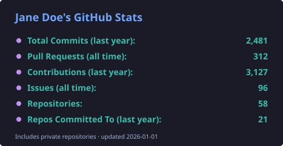
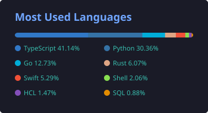
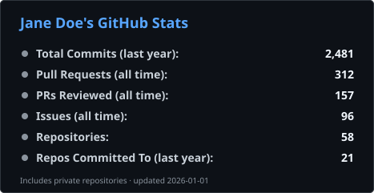
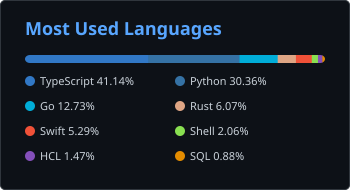
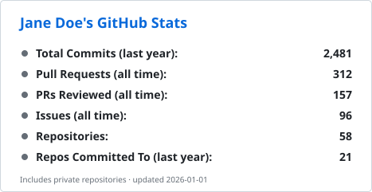
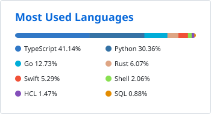
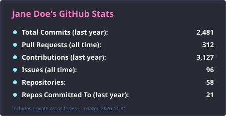
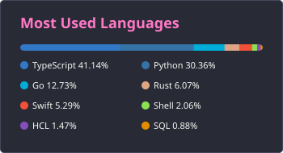

<div align="center">

# Private Stats Cards

**GitHub profile cards that count your private work too.**
Stats + top languages, rendered by a GitHub Action with a **read-only** token.
No server, no Vercel, no npm install, no repository names leaked.




<sub>Sample data. Four themes below.</sub>

</div>

---

## Why

If most of your work happens in private repositories, the usual profile cards make you look idle.
The public github-readme-stats instance can only see public data. For the author of this Action, the same account showed:

| | Public card | This Action |
|---|---:|---:|
| Commits (last year) | 142 | **10,659** |
| Pull requests | 5 | **402** |

The existing fixes all work, but each asks for something you may not want to give:

| | Counts private repos | Token it needs | What runs in your workflow | Setup |
|---|---|---|---|---|
| **private-stats-cards** (this) | Yes | **Fine-grained, read-only** (Metadata, Pull requests, Issues) | ~400 lines of standard-library Python you can read in one sitting | One step |
| [anuraghazra/github-readme-stats](https://github.com/anuraghazra/github-readme-stats) | Only if you deploy your own copy to Vercel | Classic PAT stored in Vercel | A Node server you host | Vercel deploy |
| [stats-organization/github-readme-stats-action](https://github.com/stats-organization/github-readme-stats-action) | Yes | Classic PAT with `repo` + `read:user` | `pnpm install` of npm packages on every run | One step per card |
| [jstrieb/github-stats](https://github.com/jstrieb/github-stats) | Yes | Classic PAT with `repo` + `read:user` + `user:email` | Zig build, clones your repos to count lines | Copy a template repo |
| [lowlighter/metrics](https://github.com/lowlighter/metrics) | Yes | Classic PAT with `repo` for private data | Docker image, 30+ plugins | ~10 min, many options |

<sub>Compared in November 2026 from each project's README.</sub>

A classic `repo` token can **read and write every private repository you own**. If it leaks from a secret or a compromised dependency, so does your code. This Action only needs permissions that cannot read file contents at all.

**Pick this one if** you want the two classic cards (stats + languages) with private data, and you care about what the token can do.
**Pick something else if** you want lots of card types, streaks, trophies, or lines-of-code stats.

---

## Quick start (about 2 minutes)

**1. Create a fine-grained token** at <https://github.com/settings/personal-access-tokens/new>

- **Token name:** `profile-stats` (anything)
- **Expiration:** your choice (the workflow fails with HTTP 401 when it expires; just make a new one)
- **Repository access:** `All repositories`
- **Permissions → Repositories:**
  - `Metadata`: Read-only (added automatically)
  - `Pull requests`: Read-only
  - `Issues`: Read-only
- Click **Generate token** and copy it.

**2. Save it as a secret** in your profile repository (`<you>/<you>`):
`https://github.com/<you>/<you>/settings/secrets/actions/new` → Name `STATS_TOKEN` → paste → **Add secret**.

Or with the GitHub CLI:

```bash
gh secret set STATS_TOKEN -R <you>/<you>
```

**3. Add the workflow** as `.github/workflows/stats-cards.yml`:

```yaml
name: Stats cards
on:
  schedule:
    - cron: "0 0 * * *"   # daily
  workflow_dispatch:

permissions:
  contents: write

jobs:
  cards:
    runs-on: ubuntu-latest
    steps:
      - uses: actions/checkout@v4
      - uses: jumpei-kurata/private-stats-cards@v1
        with:
          token: ${{ secrets.STATS_TOKEN }}
          hide-languages: HTML,CSS,Jupyter Notebook
```

Run it once from the **Actions** tab (**Stats cards → Run workflow**).

**4. Show the cards** in your `README.md`:

```html


```

---

## Inputs

| Input | Default | Description |
|---|---|---|
| `token` | **required** | Fine-grained PAT from step 1. `GITHUB_TOKEN` will not work: it cannot see your other repositories. |
| `cards` | `stats,languages` | Which cards to build. |
| `theme` | `tokyonight` | `tokyonight`, `github-dark`, `github-light`, `dracula`. |
| `hide-languages` | *(none)* | Comma-separated, case-insensitive. e.g. `HTML,CSS,Jupyter Notebook`. |
| `languages-count` | `8` | How many languages to list (1–20). |
| `output-dir` | `profile` | Where `stats.svg` and `languages.svg` are written. |
| `commit` | `true` | Commit and push the cards if they changed. Set `false` to handle the files yourself (outputs `stats-path`, `languages-path`). |
| `commit-message` | `chore: update profile stats cards` | |

## Themes

| Theme | Stats | Languages |
|---|---|---|
| `tokyonight` |  |  |
| `github-dark` |  |  |
| `github-light` |  |  |
| `dracula` |  |  |

---

## FAQ

**Does anything private end up in the image?**
Only totals: counts and language percentages. Repository names, descriptions and code never leave the API call. The token cannot read code anyway.

**How is each number computed?**

| Row | Source |
|---|---|
| Total Commits (last year) | `contributionsCollection.totalCommitContributions` + `restrictedContributionsCount` (private contributions GitHub only reports as one anonymous total) |
| Pull Requests / Issues (all time) | The larger of the `viewer` total and a search for `author:<you> is:pr` / `is:issue`. Fine-grained tokens can make the `viewer` total much too low; search counts everything the token can see. |
| PRs Reviewed (all time) | Search for `reviewed-by:<you> is:pr -author:<you>` |
| Repositories | Repositories you own (including forks) |
| Repos Committed To (last year) | `contributionsCollection.totalRepositoriesWithContributedCommits` |
| Languages | Bytes per language across every non-fork repository you own, top N, normalised to 100% |

**Why don't my organization's repositories count?**
A fine-grained token belongs to one owner (you or one organization). Commits to org repositories still show up in the commit total, but org repos are not in the language card. If your commit count looks low, check that **Include private contributions on my profile** is on at <https://github.com/settings/profile>.

**Light and dark mode?**
Build both themes into different folders and use GitHub's fragments:

```html


```

**Which runners work?**
Any runner with `python3` and `bash`: `ubuntu-latest` and `macos-latest`. Python 3.8+ standard library only.

**Can I pin it?**
Yes. Use a full commit SHA instead of `@v1` if you want to be sure the code you reviewed is the code that runs with your token.

**Can I run it locally?**

```bash
PSC_TOKEN=<token> python3 src/cards.py --theme dracula --output-dir out
```

or `python3 src/cards.py --demo` to render sample data without a token.

---

## Contributing

Issues and PRs welcome. Run the tests with:

```bash
python3 -m unittest discover -s tests
```

## License

[MIT](LICENSE)
